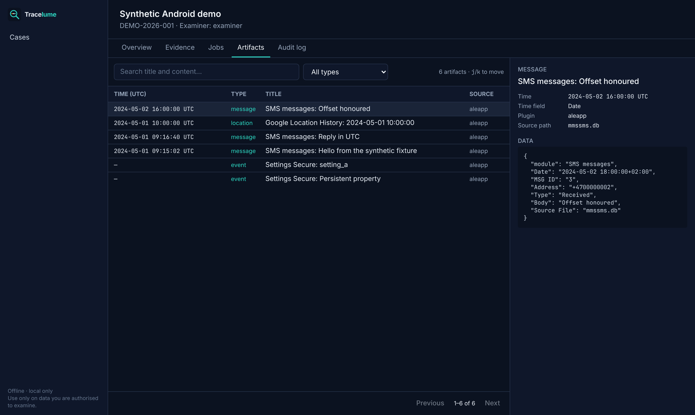
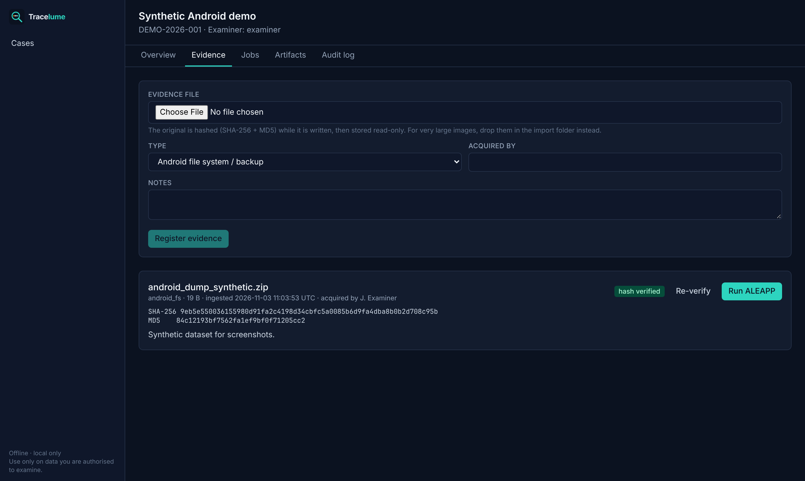
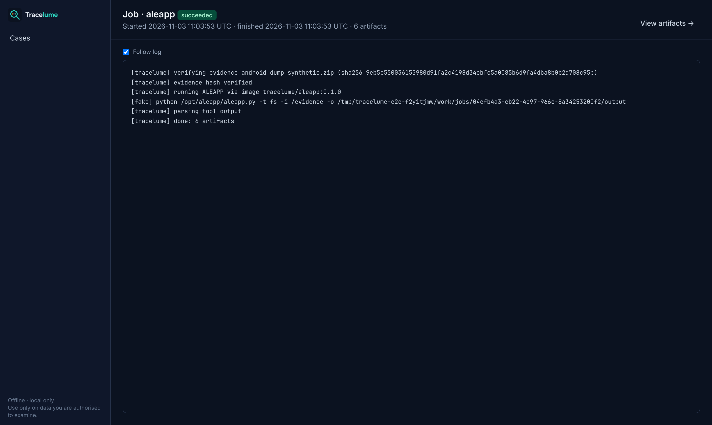

<p align="center"></p>

<p align="center"><b>Open source digital forensics workbench.</b><br>
One case database, one plugin system and one calm, fast UI on top of the open source tools examiners already trust.</p>

<p align="center">
<a href="LICENSE"></a>


</p>



## What it is
Tracelume is a **desktop-style application you run on your own workstation**. It is not a cloud
service. It takes evidence you have **already lawfully acquired** (disk images, Android and iOS
file system dumps, memory images, logs) and:

- 🔒 **Preserves integrity.** Evidence is hashed (SHA-256 + MD5) on ingest, stored read-only, and
  re-verified before every job. All actions go into a hash-chained audit log.
- 🧩 **Runs proven tools as plugins.** Each tool runs unmodified in its own container, with
  no network and read-only evidence.
- 🧭 **Normalises everything.** Every tool's output becomes common, UTC-timestamped artifacts.
- 🔎 **Lets you browse and search** artifacts across all tools, with live job logs and an
  audit view.

## Quick start
Requirements: Docker (Docker Desktop on Windows/macOS, Docker Engine on Linux).

```bash
git clone https://github.com/0xS3J4D/tracelume && cd tracelume
./tracelume tools     # build the forensic tool images (first time only)
./tracelume start     # → http://127.0.0.1:8080
```
On Windows without bash: `docker compose --profile tools build` then `docker compose up -d --build`.

**Try it with synthetic data:** `python3 scripts/make_synthetic_android.py`. Then create a case,
choose *Evidence*, and register `synthetic-android.zip` from the import folder (or upload it),
then click **Run ALEAPP**.

Large images: put them in `./import/` and register them from there. They are copied and hashed,
and the original is never touched.

## Features
| | Status |
|---|---|
| Cases, evidence registration with SHA-256 + MD5, read-only storage | ✅ |
| Re-verification before every job, hash-chained audit log | ✅ |
| Plugin system (isolated containers, `--network none`) | ✅ |
| ALEAPP (Android) | ✅ |
| Live job logs, artifact browser with search, filters and detail panel | ✅ |
| iLEAPP, Plaso, Volatility 3, The Sleuth Kit + 10 more tools | 🛠 roadmap |
| Unified zoomable timeline, conversation view, media gallery, offline map | 🛠 roadmap |
| Deleted-data recovery (file systems, SQLite freelist/WAL), read-only SQL console | 🛠 roadmap |
| Local AI assistant (offline by default) for search, summaries and investigation planning | 🛠 roadmap |
| Tags, notes, HTML/PDF reports | 🛠 roadmap |

See [PLAN.md](PLAN.md) for the architecture and milestones.

| Case overview | Evidence | Live job log |
|---|---|---|
|  |  |  |

## Documentation
- [Writing a plugin](docs/writing-a-plugin.md)
- [Chain of custody](docs/chain-of-custody.md)
- [Test data](docs/test-data.md)
- [Security model](SECURITY.md)

## ⚖️ Legal disclaimer
Tracelume is for **lawful use only**, on data you are **legally authorised to examine**
(for example under a warrant, with consent, by your organisation's mandate, or for
training data). You are responsible for complying with all applicable laws, including privacy and
data-protection law. Tracelume does **not** unlock devices, bypass security or exploit
vulnerabilities, and contributions that do will not be accepted. Results must be validated
by a qualified examiner. The software is provided **without warranty** (see GPL-3.0 §15–16).

## Support the project
Tracelume is free. If it helps you, consider [donating](DONATE.md) (Monero / Bitcoin) or contributing.

## Credits & licence
Built on the work of many open source authors, listed in [CREDITS.md](CREDITS.md).
Tracelume is licensed under **GPL-3.0-or-later**. Wrapped tools keep their own licences.
