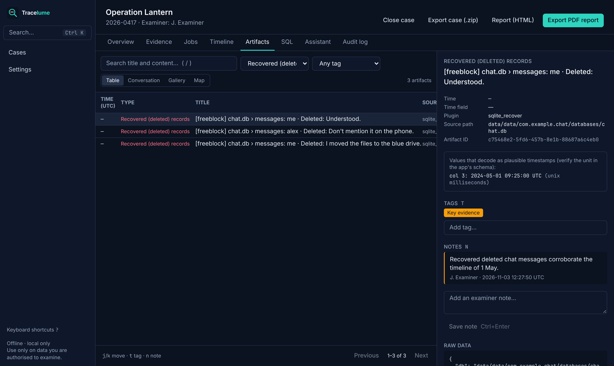
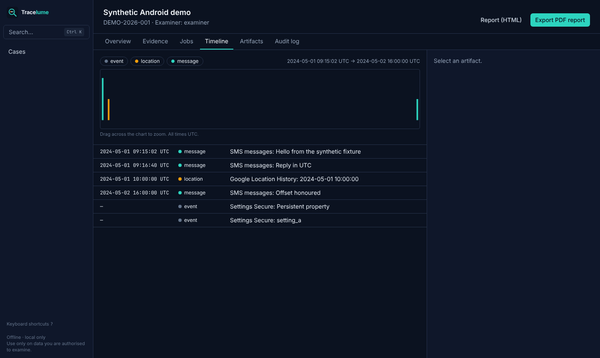
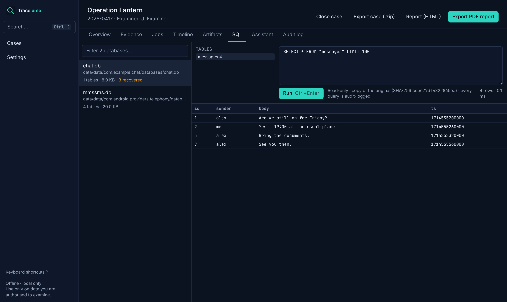
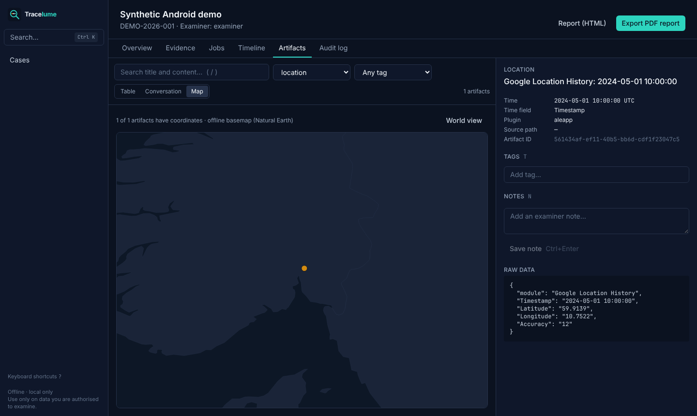

<p align="center"></p>

<p align="center"><b>The open source digital forensics workbench.</b><br>
Phones, computers, memory and logs in one case: run trusted open source tools, recover deleted data,
build one timeline, and report it with a verifiable chain of custody. It runs on your own machine,
offline.</p>

<p align="center">
<a href="LICENSE"></a>
<a href="https://github.com/0xS3J4D/tracelume/actions/workflows/ci.yml"></a>


</p>



## Why Tracelume
Examiners juggle a dozen excellent open source tools, each with its own output format, time
zone and report. Tracelume puts them behind **one case**: evidence is registered once and hashed,
every tool runs in an isolated container, and all results land in **one searchable, UTC-normalised
timeline** that you can tag, annotate and report on. The audit log is tamper-evident.

## Features
**Evidence and integrity**
- SHA-256 + MD5 on ingest; originals stored read-only; **re-verified before every analysis**
- Hash-chained **audit log** of every action (chain of custody), with a built-in verifier
- Each tool sees **only its own evidence item**, read-only, with **no network**

**Acquisition**
- **iPhone backup over USB** directly in the app (libimobiledevice; Linux hosts, beta): a standard
  logical backup of an unlocked, trusted device, hashed and registered as evidence automatically

**Analysis (17 integrations)**
| Evidence | Tools |
|---|---|
| Android | ALEAPP, SQLite deleted-record recovery, media (ExifTool), Plaso |
| iPhone / iTunes backup | iLEAPP, MVT (spyware indicators), SQLite recovery, media |
| Disk images (raw, E01) | The Sleuth Kit (**deleted files + content recovery**), Plaso |
| Windows triage (KAPE / Velociraptor) | Hayabusa, Chainsaw, EVTX, RegRipper, MFTECmd |
| Memory | Volatility 3 (Windows, Linux, macOS) |
| Anything | YARA with your own rules |

**Investigation**
- **Unified timeline** with zoom: drag across the chart to narrow the time window
- Artifact browser with a **conversation view**, **photo gallery**, **offline map** and a raw-data panel
- **Deleted data**: deleted files (TSK, $MFT) and records recovered from SQLite free space, freelists and WAL files
- **SQL workbench**: read-only queries on every database found in a phone dump
- **Case assistant (AI, optional, local-first)** answers questions about the case by calling search
  tools, shows every step, and cites the artifacts it relies on
- Global search (Ctrl+K), tags, notes, keyboard-driven (`j`/`k`, `t`, `n`, `/`, `?`)

**Reporting**
- PDF/HTML report with evidence hashes, processing steps, tagged findings, notes and the audit log
- Full **case export** (.zip): report, artifacts (CSV + JSONL), audit log, manifest, `SHA256SUMS`
- **Backups** from Settings with one click (database, evidence, results, checksum), plus restore from the launcher

| Timeline | SQL workbench | Gallery & map |
|---|---|---|
|  |  |  |

## Install
Works on **Windows 10/11, macOS (Intel and Apple Silicon) and Linux**. Requirements: **Docker
Desktop** (Windows/macOS) or **Docker Engine 26+** (Linux), 8 GB RAM, and disk space for your
evidence. On Apple Silicon the forensic tool images run through Docker Desktop's x86 emulation
(they work, but are slower).

```bash
git clone https://github.com/0xS3J4D/tracelume && cd tracelume
./tracelume tools     # first time: downloads the forensic tool images
./tracelume start     # opens http://127.0.0.1:8080
```
On Windows (PowerShell): `.\tracelume.ps1 tools`, then `.\tracelume.ps1 start`.

**Try it with demo data:** `python3 scripts/make_synthetic_android.py` creates
`import/synthetic-android.zip`. This is a fake phone with SMS, a chat app containing deleted
messages, and geotagged photos. Create a case, register the file as *Android*, then click **Run all**.

More: [User guide](docs/user-guide.md) · [Assistant](docs/assistant.md) · [Writing a plugin](docs/writing-a-plugin.md) · [Architecture](docs/architecture.md) · [Security](SECURITY.md)

## Privacy and network use
Tracelume is only reachable from your own computer (`127.0.0.1`). The analysis services run on a
Docker network with no internet route, and tool containers run with networking disabled. The
network is used only when **you** download tool images or an AI model. A remote AI endpoint is
used only if you configure one **and** allow it for a specific case.

## ⚖️ Legal
Use Tracelume **only on data you are legally authorised to examine** (under a warrant, with
consent, under your organisation's mandate, or on training data). You are responsible for
complying with applicable law, including privacy and data-protection law. Tracelume does **not**
unlock devices, bypass security or exploit vulnerabilities, and such contributions are not
accepted. Results, including AI output, must be validated by a qualified examiner. The software
is provided without warranty (GPL-3.0 §15–16). Wrapped tools keep their own licences; some, such
as MVT's, include usage conditions. See [CREDITS.md](CREDITS.md).

## Support the project
Tracelume is free and open source. If it helps your work, consider [donating](DONATE.md) (BTC, ETH, XMR), starring
the repo, or [contributing](CONTRIBUTING.md).

## Credits and licence
Tracelume stands on the work of many open source authors. See [CREDITS.md](CREDITS.md).
Licensed under **GPL-3.0-or-later**.
