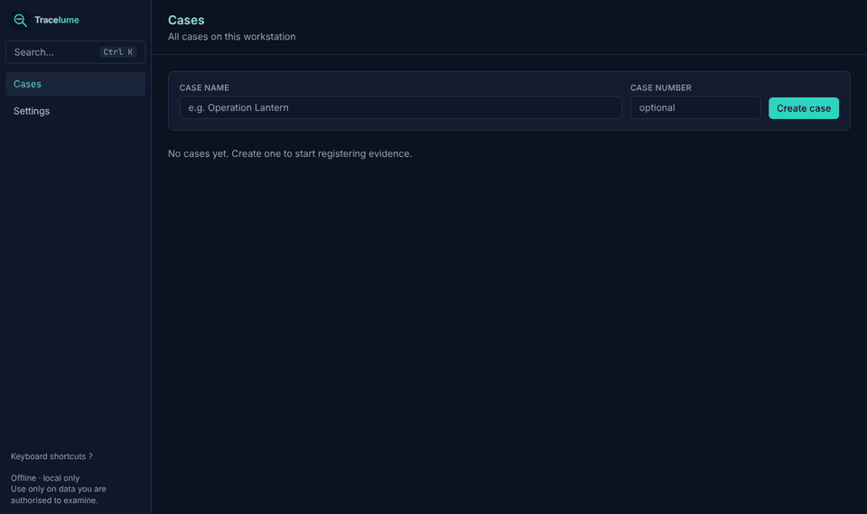
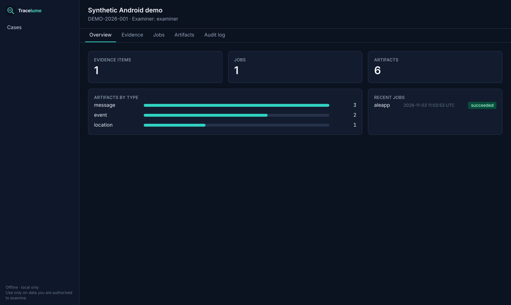
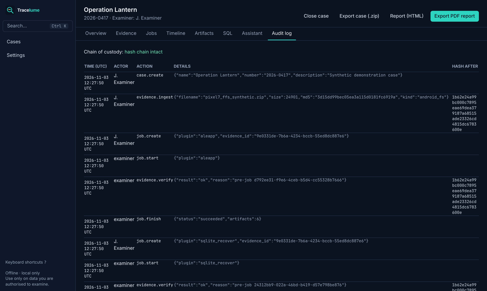

<p align="center"></p>

<p align="center"><b>The open source digital forensics workbench.</b><br>
Phones, computers, memory and logs in one case: run trusted open source tools, recover deleted data,
build one timeline, and report it with a verifiable chain of custody. It runs on your own machine,
offline.</p>

<p align="center">
<a href="LICENSE"></a>
<a href="https://github.com/0xS3J4D/tracelume/actions/workflows/ci.yml"></a>


</p>

<p align="center">
<a href="DONATE.md#bitcoin"></a>
<a href="DONATE.md#ethereum"></a>
<a href="DONATE.md#monero"></a>
</p>

<p align="center"></p>

Tracelume puts the open source forensic tools you already trust behind **one case and one
interface**. Register evidence once, run the tools in isolated containers, and work with all the
results in a single UTC timeline: messages, photos, locations, files, logs and records recovered
from deleted data. Everything you do is written to a tamper-evident audit log, and the case
exports to a PDF report with hashes. It runs on your own computer, and nothing leaves it.

## Try it in 5 minutes
You need [Docker Desktop](https://www.docker.com/products/docker-desktop/) (Windows, macOS) or Docker Engine 26+ (Linux). Start Docker first.

```bash
git clone https://github.com/0xS3J4D/tracelume
cd tracelume
./tracelume start                                              # macOS / Linux
powershell -ExecutionPolicy Bypass -File .\tracelume.ps1 start  # Windows
```

The first start builds the core tools (10–20 minutes); after that it starts in seconds. Your
browser opens **http://127.0.0.1:8080**. Then:

1. **Cases → Create case.**
2. **Evidence → From the import folder →** `synthetic-android.zip` → type *Android* → **Register evidence**.
   It's a [synthetic phone](demo/README.md) with SMS, a chat app with deleted messages, and geotagged photos.
3. **Run all**, and wait until the jobs show *succeeded*.
4. Open **Artifacts → Recovered (deleted) records**, then try the **Timeline**, the **Map**, the **SQL** tab and **Export PDF report**.

## What works today
Items marked *(beta)* work, but have not yet been tested on real devices or with real AI models.

**Evidence and integrity**
- SHA-256 and MD5 at ingest, read-only storage, re-verification before every analysis
- Hash-chained audit log of every action, with a built-in verifier
- Each tool runs in its own container with no network and sees only its own evidence item
- Register files from an import folder (for large images) or upload them
- iPhone backup over USB (libimobiledevice, Linux hosts) *(beta)*

**Analysis**
| Evidence | Tools |
|---|---|
| Android | ALEAPP · SQLite deleted-record recovery · photos and videos (ExifTool) |
| iPhone | iLEAPP · MVT (spyware indicators) · SQLite recovery · photos and videos |
| Disk images (raw, E01) | The Sleuth Kit, including deleted files and content recovery · Plaso *(beta)* |
| Windows triage (KAPE, Velociraptor) | RegRipper · MFTECmd ($MFT, deleted entries) · Chainsaw · EVTX · Hayabusa *(beta)* |
| Memory images | Volatility 3 (Windows, Linux, macOS) |
| Any file | YARA with your own rules |

**Investigation**
- One timeline for every source, in UTC; drag across the chart to zoom
- Artifact browser with conversation view, photo gallery, offline map and raw data
- Recovered deleted data: SQLite free space, freelists and WAL; deleted files (TSK, $MFT)
- Read-only SQL on every database found in a phone dump
- Search across all cases (Ctrl+K), tags and notes, keyboard shortcuts
- Case assistant (AI): local model by default, shows each step and cites the artifacts it used *(beta)*

**Reporting and operations**
- PDF and HTML report: evidence hashes, processing, tagged findings, notes, audit log
- Case export (.zip) with all artifacts as CSV and JSONL, plus `SHA256SUMS`
- One-click backups in Settings; restore from the launcher
- Runs on Windows, macOS (Intel and Apple Silicon) and Linux

**Planned**: user accounts and roles · scaling past 10 million artifacts · people and accounts
graph across apps · known-file hash sets (NSRL) · more chat-app parsers · encrypted iPhone
backups · a one-click installer. See the [roadmap](docs/architecture.md#7-status-and-roadmap).

## Screenshots
| Recovered deleted messages | Timeline | SQL on a phone database |
|---|---|---|
|  |  |  |
| **Photos with GPS on an offline map** | **Case overview** | **Audit log** |
|  |  |  |

## How it works
A FastAPI backend with PostgreSQL and a job queue, a React interface, and one Docker image per
tool. The worker checks the evidence hash, starts the tool's container with the evidence mounted
read-only and networking disabled, then turns the tool's output into common, UTC-timestamped
artifacts. Details: [architecture](docs/architecture.md) · [chain of custody](docs/chain-of-custody.md) · [security model](SECURITY.md).

**Privacy.** The interface is only reachable from your own computer (127.0.0.1). Tools run without
network access. Tracelume only goes online when you download tool images or an AI model, and it
uses a remote AI service only if you configure one and allow it for a specific case.

## Documentation
[User guide](docs/user-guide.md) · [Case assistant](docs/assistant.md) · [Writing a plugin](docs/writing-a-plugin.md) · [Test data](docs/test-data.md) · [Contributing](CONTRIBUTING.md) · [Changelog](CHANGELOG.md)

## Legal
Use Tracelume only on data you are legally authorised to examine: under a warrant, with consent,
under your organisation's mandate, or on training data. You are responsible for following the
law, including privacy law. Tracelume does not unlock devices, bypass security or exploit
vulnerabilities, and we don't accept contributions that do. A qualified examiner must validate
the results, including anything the AI assistant says. There is no warranty (GPL-3.0, sections
15–16). The wrapped tools keep their own licences, and some, such as MVT's, add conditions of use;
see [CREDITS.md](CREDITS.md).

## Support Tracelume
Tracelume is free and always will be. Donations fund development time, test phones and disks,
and keeping parsers current with every new Android and iOS release.

<table align="center">
<tr>
<td align="center" width="33%"><a id="bitcoin"></a><br></td>
<td align="center" width="33%"><a id="ethereum"></a><br></td>
<td align="center" width="33%"><a id="monero"></a><br></td>
</tr>
</table>

| | Address |
|---|---|
| **BTC** | `bc1q2tvwg0mupr2xf0g2chux4ycp35dvmczwu0pd6u` |
| **ETH** (+ ERC-20) | `0x7ec1e0C2048338b7109F83Cfde98360399237129` |
| **XMR** | `82u5eB81AkS9ZGy1BsUF5qGZVVPFt7XBr8c65sPStBHLWbPw4Pr86awaSpwSHzEZzSWrkyv4LiTync1w2muoY37gTacd5Wq` |

<sub>Only send each coin on its own network. Always check addresses against [DONATE.md](DONATE.md) in this repository; maintainers will never DM you an address.</sub>

Not into crypto? Star the repo, report bugs, or [contribute](CONTRIBUTING.md). That helps just as much.

## Credits and licence
Tracelume stands on the work of many open source authors. See [CREDITS.md](CREDITS.md).
Licensed under **GPL-3.0-or-later**.

---
<p align="center"><sub>Part of <a href="https://github.com/0xS3J4D">0xS3J4D</a>'s security portfolio</sub></p>
